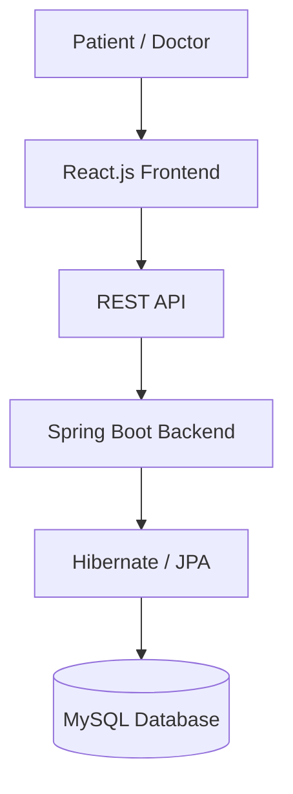

# Healthcare MediQR

**A Full-Stack Healthcare Management Application**

Healthcare MediQR is a web-based application designed to simplify healthcare management and improve patient-doctor interactions through digital services and QR-based prescription sharing.

## Key Features

- Patient and Doctor Registration & Login
- Patient and Doctor Dashboards
- Appointment Booking
- QR Code Generation and Scanning
- Health Vitals Management
- Medicine Reminders
- Notifications

## Technology Stack

- **Frontend:** React.js, JavaScript, Bootstrap
- **Backend:** Java, Spring Boot
- **Database:** MySQL
- **ORM:** Hibernate / JPA
- **Build Tool:** Maven
- **Version Control:** Git & GitHub

## Project Architecture



## Installation & Setup

**Prerequisites:** Java 17, Node.js, MySQL and Maven.

### Backend Setup

1. Clone the repository.
2. Open the Spring Boot project in Eclipse or IntelliJ IDEA.
3. Configure MySQL database credentials using environment variables or local application properties.
4. Run the Spring Boot application.

### Frontend Setup

```bash
npm install
npm start
```

## Developer

**Tanvi Mohite**

[GitHub Profile](https://github.com/mohitetanvi06-ai)

---

*Developed as a Full-Stack Healthcare Management Project.*
